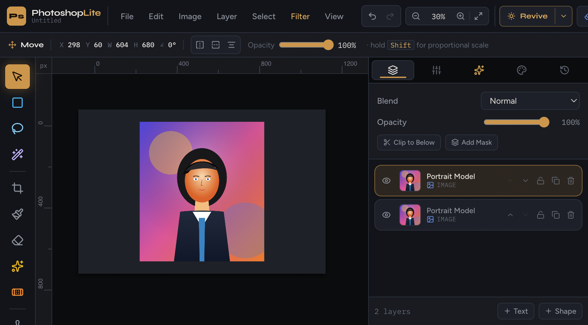
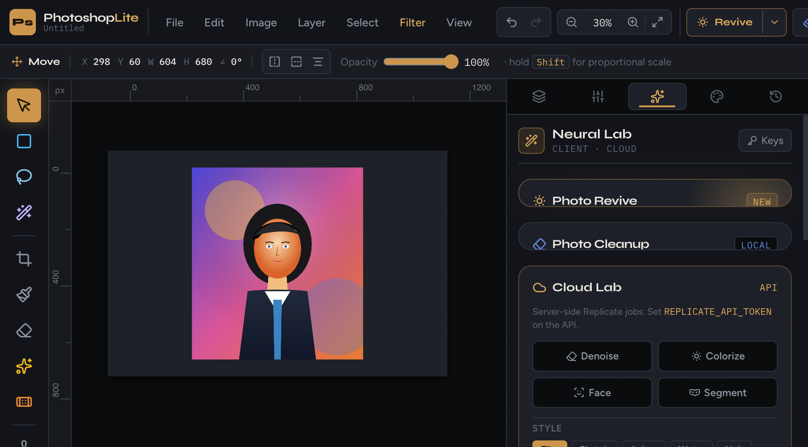
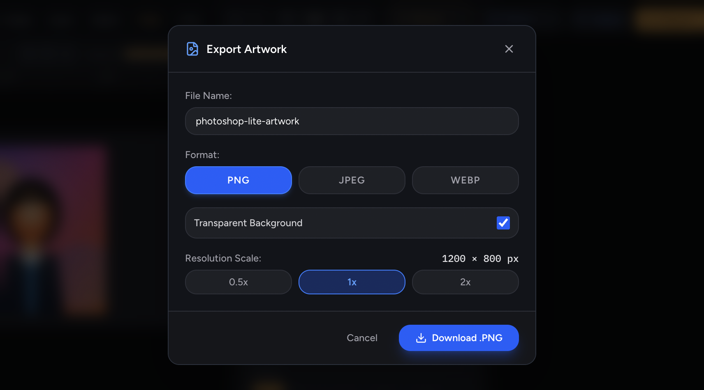

# PhotoshopLite

Browser darkroom editor — layers, retouch tools, local Neural Lab, and optional cloud AI via a NestJS proxy.

<p align="center">
  
</p>

## Screenshots

| Workspace | Neural Lab | Export |
| --- | --- | --- |
|  |  |  |

## Features

- **Canvas** — Konva stage with layers, marquee / lasso / wand, brush, heal, clone, shapes, text
- **Local AI** — Photo Revive, Cleanup, WASM cutout, client upscale
- **Cloud Lab** — Denoise, colorize, face restore, inpaint, style, segment, caption (Replicate via API)
- **Projects** — `.pslite` local save + Save to Cloud / Open from Cloud (`apps/api/data/workspaces/{id}`)
- **Workspace isolation** — each browser gets `X-Workspace-Id` so person A never overwrites person B
- **Traffic guards** — per-workspace rate limits, project/asset quotas, atomic disk writes, AI concurrency cap
- **Redis** — optional shared cache + throttling (`REDIS_URL`); falls back to in-memory
- **API cache** — Nest `CacheModule` for project lists/details, assets list, and fonts catalog
- **Export** — PNG / JPEG / WEBP with transparent background and scale

## Quick start

```sh
bun install   # or npm install

# One-shot: .env + Redis + editor + API
./scripts/dev.sh
# or: bun run dev:all
```

| Script | What it does |
| --- | --- |
| `./scripts/dev.sh` / `bun run dev:all` | `.env`, Redis (Docker), then editor + API |
| `bun run dev` | Turbo: Vite editor (`4200`) + Nest API (`3001`) |
| `bun run dev:editor` | Editor only |
| `bun run dev:api` | API only |
| `bun run redis:up` / `redis:down` | Start / stop Redis container |
| `bun run build` | Turbo build all packages |
| `bun run test` | Turbo test all packages |
| `bun run test:konva` | `@photoshop-lite/editor-konva` unit tests |

## Environment

See [`.env.example`](.env.example):

- `REPLICATE_API_TOKEN` — server-side Replicate key for Cloud Lab
- `HF_TOKEN` — Hugging Face Inference fallback (caption / upscale / segment hint)
- `PIXABAY_API_KEY` — Pixabay stock search
- `REMOVE_BG_API_KEY` — optional remove.bg
- `DATA_DIR` — projects/assets root (default `apps/api/data`)
- `PORT` — API port (default `3001`)
- `VITE_SITE_URL` — public origin for SEO (canonical, Open Graph, `sitemap.xml`, `robots.txt`)

Client API keys in Settings remain an optional override; server env keys are preferred.

## SEO

Production editor ships with:

- Rich meta / Open Graph / Twitter cards in `apps/editor/index.html`
- JSON-LD (`WebApplication`, `WebSite`, `Organization`, `BreadcrumbList`, `FAQPage`)
- Per-route client meta via `apps/editor/src/seo/usePageMeta.ts` (`/` indexable, `/editor` noindex)
- `public/sitemap.xml`, `public/robots.txt`, `public/site.webmanifest`
- Static cache headers: `public/_headers`, `vercel.json`
- `og-image.png` (1200×630)

Set `VITE_SITE_URL` before `npm run build` so absolute URLs match your deploy host.

## API cache & rate limits

- `CacheService` + Nest Throttler — **Redis** when `REDIS_URL` is set, otherwise in-memory
- HTTP `Cache-Control` on fonts/stock/health/assets (via `@CacheControl`)
- Throttler keyed by `X-Workspace-Id` (else IP) — tune with `THROTTLE_*` in `.env`
- Per-workspace quotas (`WORKSPACE_MAX_*`) + `AI_MAX_CONCURRENT` for spike protection

```sh
docker compose up -d redis
# in .env
REDIS_URL=redis://127.0.0.1:6379
bun run dev:api
# GET /api/health → { "redis": "connected" }
```

> Disk projects/assets stay local (`DATA_DIR`). For multi-instance storage, move that to shared object storage next.

## Monorepo layout (Turborepo)

```
apps/editor            React editor (react-konva + Zustand)
apps/api               NestJS AI proxy + local projects/assets
apps/editor-e2e        Cypress
libs/ai                Replicate / remove.bg engine
libs/editor-ai-client  Fetch client + poll helpers
libs/editor-core       Pixel ops, project file, masks
libs/editor-konva      react-konva glue (filters, stage, export, hooks)
libs/shared/types      Shared DTOs
```

Orchestration: [`turbo.json`](turbo.json) · workspaces in root `package.json`.

## Architecture (AI + storage)

```
Editor Neural Lab → editor-ai-client (+ X-Workspace-Id) → NestJS /api
  → AiEngineService → Replicate / remove.bg
  → ProjectsService / AssetsService → data/workspaces/{workspaceId}/…
  → CacheService (in-memory TTL, workspace-scoped keys)
  → ThrottlerGuard (default / ai / stock buckets)
```

## License

MIT
